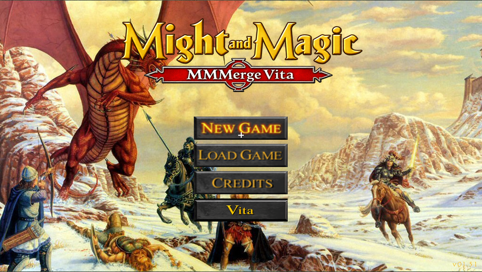
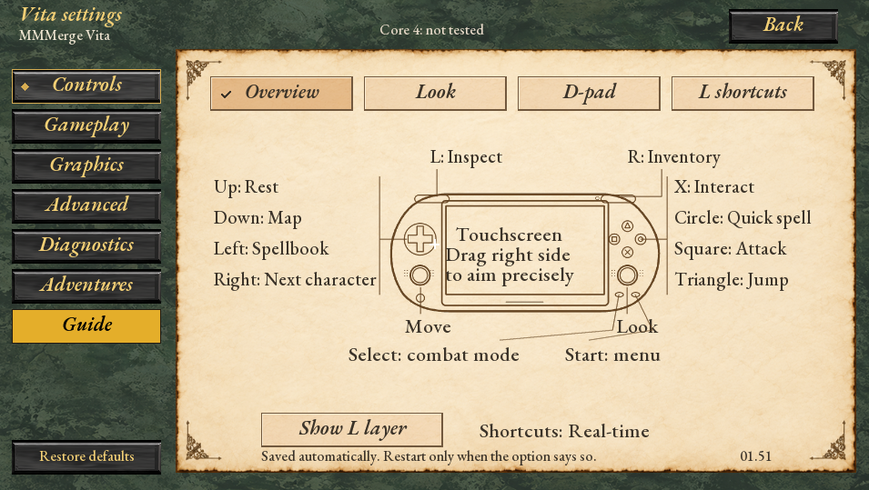
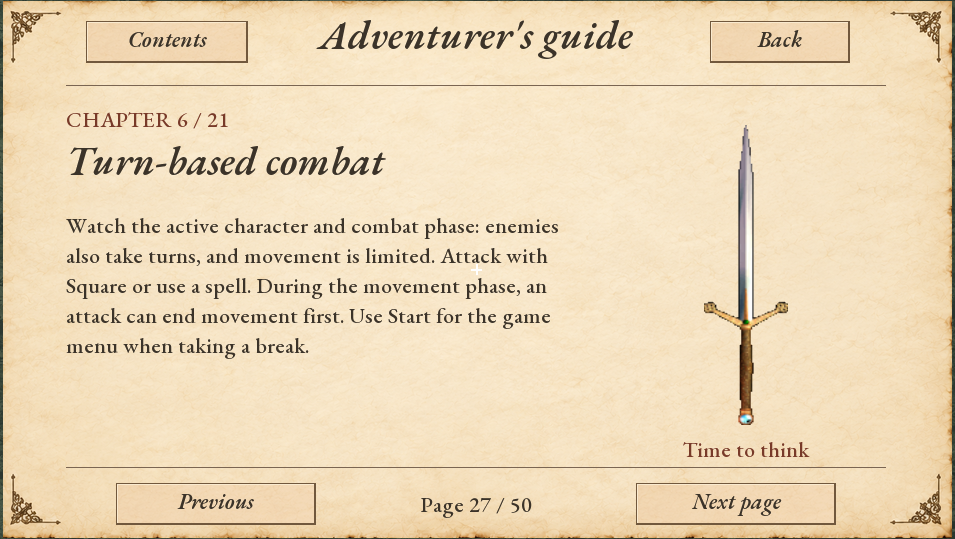
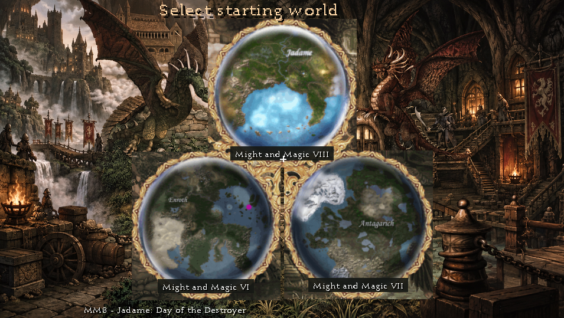
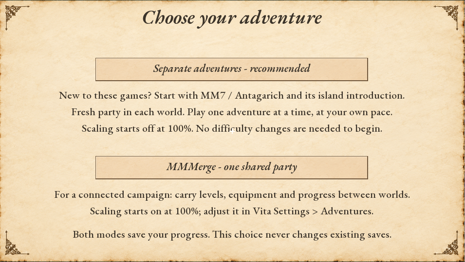
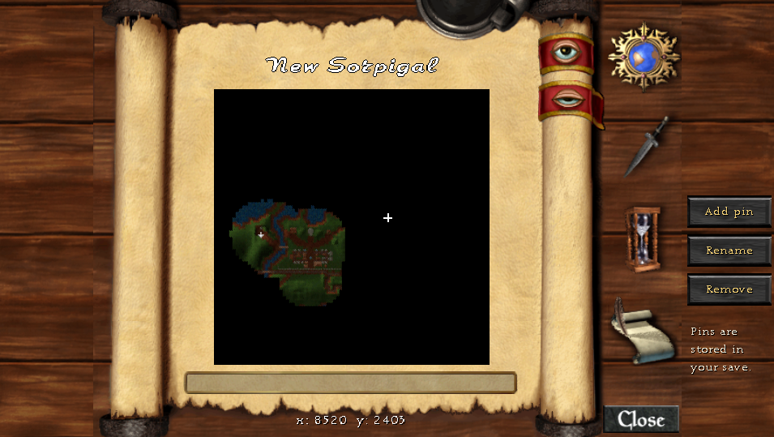
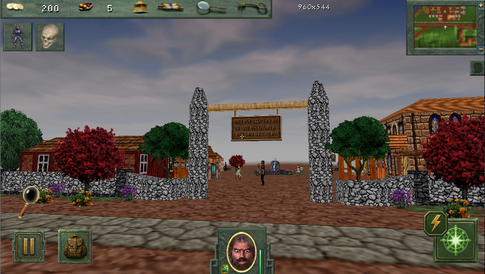
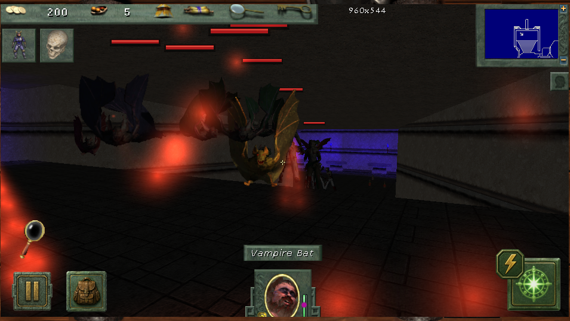
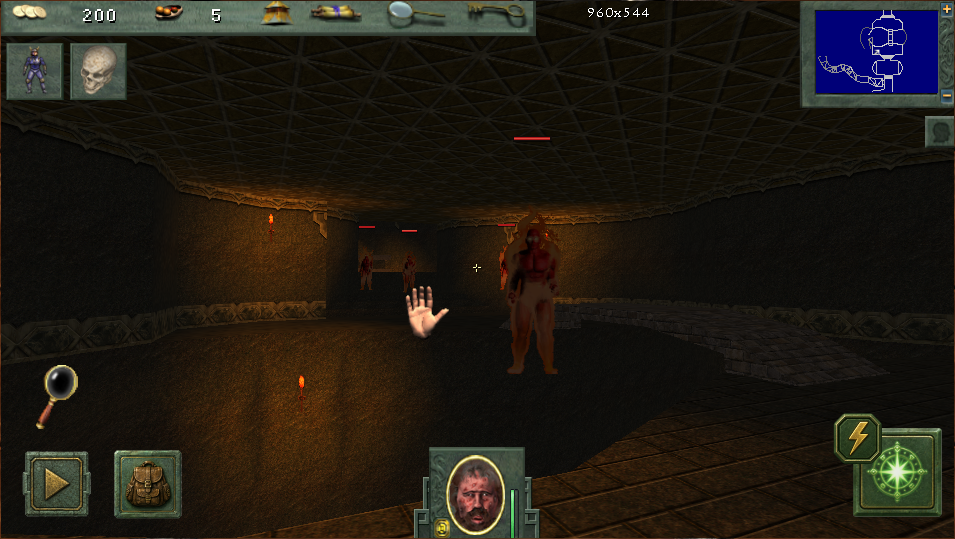
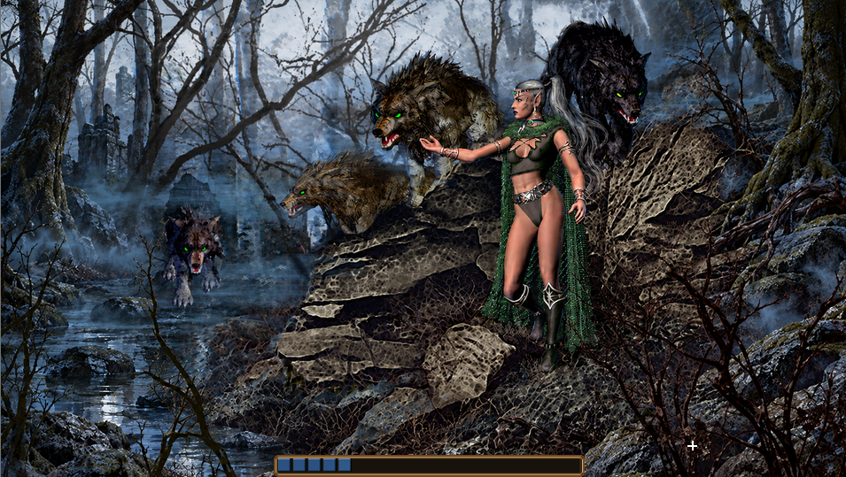

# MMMerge Vita



**Might and Magic VI, VII and VIII on PlayStation Vita, through OpenYAMM.**

[Downloads](https://github.com/sapouni/MMMerge-Vita/releases) · [Install](#installation) · [Build game data](#windows-asset-builder) · [Controls](#controls) · [Credits](#credits)

MMMerge Vita is an unofficial Vita port of [OpenYAMM](https://github.com/pjasicek/openyamm), bringing together the worlds of Might and Magic VI, VII and VIII. Choose Enroth, Antagarich or Jadame as your starting world. Vita controls, remappable shortcuts, a touchscreen aiming option, native-resolution menus and an in-game guide are included.

**Current playtest: 01.52. Windows Asset Builder: 0.3.0.** This is a work in progress. Crowded dungeons can still slow down and console/debug loading can still fail. 01.52 has desktop build/behavior checks; physical acceptance of this exact candidate and the newly generated data remains pending. No minimum framerate is promised.

## Screenshots

Custom Vita menus and controls alongside the original adventures. Click any image for the full-size screenshot. These captures show the interface and game content; they are not performance benchmarks.

| Remappable Vita controls and touch aiming | Full-screen adventurer's guide |
|---|---|
| [](docs/images/screenshots/controls.png) | [](docs/images/screenshots/guide.png) |
| **Choose a starting world** | **Separate adventures or one shared party** |
| [](docs/images/screenshots/world-selection.png) | [](docs/images/screenshots/adventure-modes.png) |
| **Custom map pins saved with your game** | **Exploring the three worlds** |
| [](docs/images/screenshots/map-pins.png) | [](docs/images/screenshots/outdoor-gameplay.png) |

<details>
<summary>More screenshots: dungeon combat, exploration and loading artwork</summary>







</details>

## Downloads

| Download | Use it for |
|---|---|
| [Latest VPK — 48 MB (recommended)](https://github.com/sapouni/MMMerge-Vita/releases) | Download **MMMerge-Vita-01.52.vpk** and install it directly with VitaShell. Existing players with working game data need only this file. |
| [Windows Asset Builder — 156 MB](https://github.com/sapouni/MMMerge-Vita/releases) | Creates all five required data archives from supported installed English GOG MM6, MM7 and MM8. New players need this plus the game VPK. |

**For normal play:** install the **VPK**; extract only the **Windows builder ZIP** if you need to create game data. Keep the VPK intact for VitaShell. The VPK already contains the custom menus, guide, shaders and game libraries.

Older **private-test ZIPs** contain manual-update files, test presets and diagnostic tools. The 01.52 player download is the standalone VPK. Installation and controls are documented on this page, and the Guide is inside the game. Source snapshots are for development. Prepared original-game archive sets are not hosted here.

## Requirements

| Requirement | What you need |
|---|---|
| Homebrew-enabled Vita | [VitaShell](https://github.com/TheOfficialFloW/VitaShell/releases) for manual transfers and VPK installation. No firmware update is required for this release on a working setup. |
| **kubridge installed and loaded** | The compatible release used by this port is [bythos14 v0.3.1_hotfix](https://github.com/bythos14/kubridge/releases/tag/v0.3.1_hotfix). Follow its setup instructions and reboot after changing kernel plugins. |
| **libshacccg.suprx** | The extracted shader compiler at `ur0:data/libshacccg.suprx` or `ur0:data/external/libshacccg.suprx`. See [ShaRKF00D](https://github.com/OsirizX/ShaRKF00D#install-instructions). |
| **CapUnlocker — fourth-core plugin** | Recommended for fourth-core jobs; optional to launch the game. Download **CapUnlocker.skprx** from [GrapheneCt’s releases](https://github.com/GrapheneCt/CapUnlocker/releases). [Setup is below](#first-time-plugin-setup); [source and license](https://github.com/GrapheneCt/CapUnlocker) are by GrapheneCt. Diagnostics shows whether access and worker jobs actually work. |
| [Game data](#windows-asset-builder) | Create the five required archives from your installed MM6, MM7 and MM8 using the [Windows Asset Builder](#windows-asset-builder), or keep an existing matching prepared set. |
| Storage | Allow about 2 GB on the Vita plus installation/cache/save space. The PC builder needs at least 8 GiB free on its output drive while converting. |

An Android APK, a separate vitaGL installation and the experimental libperf kernel plugin are **not required**. Do not enable the withdrawn libperf plugin from earlier private experiments.

Keep working YAMT/SD2Vita entries intact and back up the active tai configuration before plugin changes. Copying a kernel plugin alone does not activate it. No plugin changes are needed just to update an already working installation.

### First-time plugin setup

For a fresh physical Vita setup, copy the compatible **kubridge.skprx** and, if using the fourth core, **CapUnlocker.skprx** to `ur0:tai/` with VitaShell. Add the applicable lines **under the existing `*KERNEL` section** of your active tai configuration:

```text
ur0:tai/kubridge.skprx
ur0:tai/CapUnlocker.skprx
```

Keep your existing storage/YAMT/SD2Vita entries and avoid duplicate plugin entries. Reboot the Vita after adding a kernel plugin; copying its file alone does not activate it. The shader compiler is installed separately using ShaRKF00D as linked above. See [detailed plugin instructions](docs/PLUGINS.txt). A working setup needs no plugin changes for an app update. Vita3K does not use these physical-console plugins.

## Installation

1. Download **MMMerge-Vita-01.52.vpk** from [Releases](https://github.com/sapouni/MMMerge-Vita/releases). Keep it intact; install the VPK itself.
2. If you do not already have matching prepared game data, use the [Windows Asset Builder](#windows-asset-builder) to create it from your installed originals.
3. Copy **engine.zip** and the **worlds** folder into `ux0:data/openyamm/assets/` exactly as shown below. Keep these five inner ZIPs packed.
4. Transfer **MMMerge-Vita-01.52.vpk** to the Vita and install it through VitaShell. It creates the home-screen bubble on a fresh installation and updates **MMVITA001** on an existing one.
5. Launch the game. Leave diagnostic recording **off** for ordinary play. Open the in-game **Guide** for controls and adventure choices; the [settings section](#settings-and-testing) explains the recommended baseline for previous testers.

```text
ux0:data/openyamm/
└── assets/
    ├── engine.zip
    └── worlds/
        ├── mm6.zip
        ├── mm7.zip
        ├── mm8.zip
        └── mmmerge.zip
```

**The `openyamm` folder name is still current.** It is the path used by the 01.52 app, including saves and settings. The project/repository rename to **MMMerge Vita** does not change that folder or app ID **MMVITA001**.

Do not rename the originals' LOD/SND/VID files to these ZIP names or unpack the five generated archives. `ux0` means the Vita's currently mounted application storage, often SD2Vita.

### Updating without losing saves

Back up `ux0:data/openyamm` first, then install the new VPK over app ID **MMVITA001**. Saves and personal settings are outside the installed app and are not included or replaced by the update. Leave working game-data archives in place. Do not replace or delete the whole data folder and do not overwrite your settings with a preset fragment.

Very old installs using **OYAM00001** should move their five archives from the old app folder into the layout above, retaining backups and the old bubble until the new app finds their data. See [detailed installation notes](docs/INSTALL.txt).

### Vita3K

Use the **same VPK and generated data files**. Install the VPK and place the archives in Vita3K's emulated `ux0/data/openyamm/assets`. Do not install the physical-console kernel plugins into the emulator. Hardware Vita is the priority; emulator compatibility is not guaranteed and does not replace physical testing.

## Windows Asset Builder

1. Install the original **English GOG** releases of MM6, MM7 and MM8.
2. Extract the entire builder ZIP. Run **MMMerge Vita Asset Builder.exe**, keeping its `_internal` folder and other files beside it.
3. Select the three installed game folders themselves, **not** their `Data` folders or installers.
4. Choose a **new or empty output folder**, then press **Build complete game data**. Allow at least 8 GiB free on that drive. Video conversion can take several minutes.
5. After success, follow `INSTALL-DATA.txt` in the output and copy the five archives to the Vita. `MMMerge-build-report.json` records the output hashes.

No separate Python, FFmpeg, MMMerge mod installation or OpenYAMM download is needed. The tool reads the original games without modifying them and publishes only a fully verified output set. It never connects to the Vita or changes plugins/firmware.

**Supported inputs are specific:** this version verifies 71 English GOG container/music files by size and SHA-256. Other revisions, languages, CD editions and modified files are rejected with an input error instead of silently producing incompatible data.

Most data is extracted, converted or patched locally from the originals. Bundled supplemental content provides the merged scripts, tables, scenes, extra art/voices, custom maps and remaining residual media. Its inventory is included. Some supplemental-media provenance remains untraced; the tool is not claimed to contain zero original-derived payload. Original installers and original LOD/SND/VID containers are not bundled.

**Validation:** the portable tool completed an end-to-end conversion. All **53,216 nonvideo files** match the prepared 01.51 data set used unchanged by 01.52; **529 videos** are locally re-encoded. All **438 unique clips**, covering the **529 video paths**, passed full desktop decoding and original-stream timing/audio checks. A separate fresh user conversion also passed all five archive hashes and the complete file/video checks. The smaller MM6/MM7 ZIPs mainly reflect compression; no files are omitted. Physical Vita loading/playback performance and a full generated-data playthrough remain unverified. See [builder details](docs/ASSET-BUILDER.md).

## Choose your adventure

- **Separate adventures — recommended for newcomers:** each world has its own fresh party. The new-game screen recommends MM7/Antagarich and its island introduction. Scaling starts off at 100%.
- **MMMerge — one shared party:** carry levels, equipment and progress between worlds. Scaling starts on at 100%; adjust it in **Vita settings → Adventures**.

The choice belongs to the new adventure and does not change existing saves. Adventure settings explain the active save, scaling controls and explicit conversion choices. Back up saves before conversions. Custom map pins are stored in your save, and the full-screen Guide covers combat, spells, equipment, potions, companions and Vita-specific controls.

## Controls

**A button mapper is included:** open **Vita settings → Controls** to change the supported bindings, look settings, D-pad shortcuts and L shortcut layer. The Vita diagram updates to show your saved bindings. Use **Show L layer** to view the modifier shortcuts. Updates preserve existing bindings, so your own layout may differ from these defaults.

[](docs/images/screenshots/controls.png)

### Default gameplay buttons

| Input | Action |
|---|---|
| Left stick | Move |
| Right stick | Look |
| Touchscreen — drag the right side | Move the camera precisely for aiming and targeting |
| Cross (X) | Interact |
| Square | Attack |
| Circle | Cast the quick spell; attack if no quick spell is assigned |
| Triangle | Jump |
| L | Inspect the target |
| R | Open inventory |
| D-pad Up | Rest |
| D-pad Down | Map |
| D-pad Left | Spellbook |
| D-pad Right | Next character |
| Select | Toggle combat mode |
| Start | Open the game menu |

### Default L combinations

Hold **L** and press the second button. By default this layer works during **real-time gameplay**; turn-based combat keeps L available for inspection. The mapper lets you change when the layer is active and what its shortcuts do.

| Combination | Action |
|---|---|
| L + D-pad Up | Fly up |
| L + D-pad Down | Fly down |
| L + D-pad Left | Land |
| L + D-pad Right | Map |
| L + Cross (X) | Interact |
| L + Circle | Quick spell |
| L + Square | Attack |
| L + Triangle | Rest |
| L + R | Party overview |

### Menus and spells

In menus, move the pointer with the **left stick** and select with **Cross**, or use the **touchscreen**. Open the spellbook, select a learned spell with Cross and press **Triangle** to assign its quick-spell slot; Circle inspects it. The in-game **Guide** covers inventory, combining potions, combat and merged-world changes. Restart only when an option explicitly says it is needed.

## Settings and testing

**New installs default to diagnostics off, the resolution label hidden and the slide debug console disabled.** Existing personal settings are preserved. Previous testers can turn off **Record diagnostics** and **NPC movement timings** in Diagnostics, **Show world resolution** in Graphics, and **Slide debug console** in Advanced. Keep the standalone timeline off as well. The Guide starts with controls and practical play tips; world modes, travel and conversion are explained near its end.

Use the in-game baseline before controlled testing: **Standard** compiler, existing fourth-core jobs/priority on, **outdoor facts off**, **Tighter indoor queries off**, **Shared actor helper pool off**. The baseline preserves controls, graphics quality and adventure state. The shared-pool switch is an experiment and requires restarting the game; it is not an established speed improvement.

Keep **Record diagnostics**, NPC movement timings and timeline profiling **off** for normal play and FPS comparisons. Use a separate recording run for diagnosis; capture can slow the game. Compare the same save, route and settings. Crowded Alamos/map 180 and the starting-island cannon battle remain useful test scenes; an empty view is not an equivalent benchmark.

Adaptive resolution responds to rendering pressure. It can stay high when enemy movement/AI is the limiting work; lowering pixel count does not reduce those calculations. Restart only when the setting explicitly says so. See [01.52 release notes](docs/releases/01.52.md) and [known issues](docs/KNOWN-ISSUES.md).

## Source and contributions

The [release](https://github.com/sapouni/MMMerge-Vita/releases) also includes optional developer downloads: the frozen 01.51 engine source snapshot and corresponding bgfx source snapshot. The exact 01.52 source, symbols and configuration are preserved locally; its changes are documented in the release notes. [Builder source](builder/) is in this repository; its large versioned conversion resources travel with the builder release rather than in Git history. The older checked-in engine/dependency tree is retained as historical review material, not advertised as a fresh-clone current build kit. See [build status](docs/BUILD.md).

Report the version, map/save, reproduction steps, changed settings and capture mode when [filing an issue](https://github.com/sapouni/MMMerge-Vita/issues). Back up saves before testing updates or adventure conversions.

## Credits

This port depends on the original game creators, the Might and Magic community and the Vita homebrew scene.

| Contributor / project | Contribution |
|---|---|
| **New World Computing and the original Might and Magic teams** | Might and Magic VI, VII and VIII, originally published by 3DO. |
| **[pjasicek / Tyrkys](https://github.com/pjasicek/openyamm) and OpenYAMM contributors** | The engine this port adapts, plus shared original-engine research and performance advice. |
| **Rodril and the MMMerge contributors** | The merged-world project and community work that inspired OpenYAMM. |
| **[OpenEnroth contributors](https://github.com/OpenEnroth/OpenEnroth)** | Engine research and community work, also acknowledged by OpenYAMM. |
| **[TheFloW / Andy Nguyen](https://github.com/TheOfficialFloW)** | VitaShell, the original kubridge and shared-library loader work. |
| **[bythos14](https://github.com/bythos14/kubridge)** | The extended kubridge implementation used by this port. |
| **[Rinnegatamante](https://github.com/Rinnegatamante/vitaGL) and contributors** | vitaGL, vitaShaRK and Vita graphics infrastructure. |
| **[OsirizX](https://github.com/OsirizX/ShaRKF00D) and contributors** | ShaRKF00D shader-compiler extraction tooling. |
| **[GrapheneCt](https://github.com/GrapheneCt/CapUnlocker)** | CapUnlocker, the optional fourth-core capability plugin (MIT license). |
| **[VitaSDK contributors](https://github.com/vitasdk)** | The Vita homebrew toolchain and SDK. |
| **bgfx/bx/bimg, SDL, FFmpeg, PhysicsFS, Lua and other dependency authors** | Rendering, platform support, media, asset access and scripting. Their notices remain with the included sources. |
| **[sapouni](https://github.com/sapouni)** | Vita project coordination, extensive hardware playtesting, bug reports and feedback. |

Development assistance: **OpenAI Codex**, with additional source-review feedback using **Claude**.

Might and Magic names, original game content and artwork belong to their respective rights holders. This is an unofficial community project. See [source attribution and licensing status](LICENSE-NOTICE.md) for the upstream and dependency notices.
