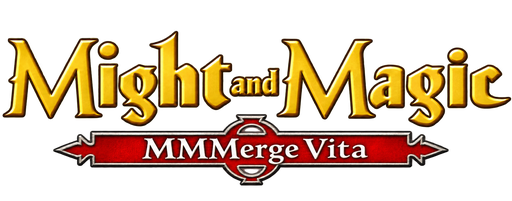

# MMerge Vita



**Might and Magic VI, VII and VIII on PlayStation Vita, through OpenYAMM.**

[Download](https://github.com/sapouni/MMerge-Vita/releases/tag/v01.06-r2) · [Requirements](#requirements) · [Installation](#installation) · [Controls](#controls) · [Credits](#credits)

---

## What this is

MMerge Vita is an unofficial PS Vita port of [OpenYAMM](https://github.com/pjasicek/openyamm), a modern reimplementation of Might and Magic VI, VII and VIII inspired by MMMerge. Choose a starting world and explore the three games with one party.

The port runs an adapted ARMv7 Android engine through the Vita community's shared-library loader and vitaGL. The engine, Vita controls, menus and supporting libraries are included in the installer; the prepared game-data archives are supplied separately.

- **Three starting worlds:** Enroth (MM6), Antagarich (MM7) and Jadame (MM8).
- **Vita controls:** twin-stick movement and aiming, touch input, remappable shortcuts and quick-spell assignment.
- **Vita menus:** a beginner's guide, graphics and control settings, and the Vita keyboard for save names and bank amounts.
- **Display:** 960 × 544 interface, with optional lower or adaptive 3D resolution.
- **Status:** playable on a physical Vita, with ongoing compatibility and performance work. Large battles and crowded caves can still slow down.

**Current package: 01.06 R2.** The repository and downloads are private for now. R2 contains the same game code as 01.06 under a new app identity to address LiveArea artwork registration. The separate artwork test passed; the new full-game bubble still awaits hardware confirmation.

## Requirements

| Requirement | What you need |
|---|---|
| PS Vita with homebrew enabled | [VitaShell](https://github.com/TheOfficialFloW/VitaShell/releases) to transfer files and install the VPK. |
| **kubridge** | The kernel plugin installed **and loaded**. See [kubridge releases](https://github.com/bythos14/kubridge/releases). Reboot after installing or changing kernel plugins. |
| **libshacccg.suprx** | The extracted shader compiler at `ur0:data/libshacccg.suprx`. Follow [ShaRKF00D's setup instructions](https://github.com/OsirizX/ShaRKF00D#install-instructions). |
| Prepared OpenYAMM data | The five archives shown below. See the [upstream OpenYAMM project](https://github.com/pjasicek/openyamm) for its asset packaging. |
| Free storage | The tested five archives total about **1.4 GB**. Leave additional space for the app, generated caches and saves. |

You do **not** need an Android APK or a separate vitaGL installation. The Vita program and supporting libraries are already in the VPK.

## Installation

1. **Prepare the requirements above.** Install kubridge and the shader compiler if missing, then reboot the Vita.
2. **Download the [01.06 R2 installer ZIP](https://github.com/sapouni/MMerge-Vita/releases/tag/v01.06-r2)** and extract it on your computer. The VPK is inside; GitHub's automatic “Source code” downloads are not the installer.
3. **Copy the five prepared game-data archives** to `ux0:data/openyamm/assets/`, exactly as shown below. Keep these inner archives zipped.
4. **Transfer `MMerge-Vita-01.06-R2.vpk`** using VitaShell USB or FTP. When the transfer finishes, leave USB mode and install the VPK in VitaShell.
5. **Launch the new MMerge Vita bubble.** If the startup check lists a missing requirement, fix that item first. Choose New Game and a starting world, or load your save. The in-game Guide explains the basic systems and controls.

### Game-data folder

```text
ux0:data/openyamm/
└── assets/
    ├── engine.zip
    └── worlds/
        ├── mmmerge.zip
        ├── mm6.zip
        ├── mm7.zip
        └── mm8.zip
```

These are **OpenYAMM-prepared archives**, not files taken unchanged from a GOG installation. `engine.zip` contains shared game data; it is separate from the executable included in the VPK. Original game-data archives are not hosted here.

Use a matching set; do not rename raw game files to these names. Compatibility with every future upstream asset revision is not guaranteed. The [tested data manifest](vita/game-data-manifest.json) records the set used during development.

### Updating an existing installation

- Back up `ux0:data/openyamm` first. Saves, settings and caches live there, outside the installed app.
- If the archives are already in the folder above, **leave them there**; no large transfer is needed.
- If they are still under `ux0:app/OYAM00001/assets`, copy the five archives into the data-folder layout above first.
- R2 installs a **new bubble**, app ID `MMVITA001`. Keep the old `OYAM00001` bubble until the new one launches and finds your saves. Both use the same data folder.
- For later updates to the new bubble, install the new VPK over it and follow that release's instructions.

No manual `app.db` edits or artwork-cache copying are needed. See [detailed installation notes](docs/INSTALL.txt) if you use a custom asset path.

## Controls

These are the defaults. Updates preserve existing custom bindings.

| Vita input | In-game action |
|---|---|
| Left stick | Move |
| Right stick | Look / aim |
| Cross (X) | Interact with the current target |
| Square | Attack |
| Circle | Cast the active character's quick spell; attack if none is assigned |
| Triangle | Jump |
| L / R | Inspect the crosshair target / open inventory |
| D-pad up / down | Map / rest |
| D-pad left / right | Spellbook / next character |
| Select | Toggle turn-based combat |
| Start | Open the game menu |

**In menus:** move the pointer with the left stick and select with X, or use touch. Circle inspects inventory items; with an item held, it can apply that item instead.

**Assign a quick spell:** open the spellbook, select a learned spell with X, then press **Triangle**. Close the book and use Circle to cast it. Circle still inspects spells while the book is open.

**More shortcuts:** hold L for a second set of bindings. L + D-pad up/down controls flight height when Fly is active. Open **Vita Settings → Controls** for all bindings and customization.

## Settings and performance

Open **Vita** from the main menu or the Start menu. Settings include controller bindings, graphics options, an optional gameplay FPS cap and advanced diagnostics. Each setting indicates whether it needs a restart.

Start with the defaults. Adaptive world resolution can help when 3D rendering is the limit while keeping the interface at native resolution. Large numbers of enemies can still cause slowdowns.

Keep **diagnostics off for normal play**. Captures help investigate problems but can reduce performance. Loading and first-time cache preparation may also take time.

## Help

- **Missing data:** check the folder layout, including `assets/worlds/` and the unchanged ZIP filenames.
- **kubridge not detected:** confirm the plugin is loaded and reboot after any plugin change. Having the file on the card is not enough.
- **Shader compiler missing:** check `ur0:data/libshacccg.suprx` and follow the extraction instructions linked above.
- **Report a bug:** include the version, location, reproduction steps, changed settings and whether diagnostics were enabled.

[Known issues](docs/KNOWN-ISSUES.md) · [Release notes](https://github.com/sapouni/MMerge-Vita/releases) · [Report an issue](https://github.com/sapouni/MMerge-Vita/issues)

## Credits

This port depends on the original game creators, the Might and Magic community and the Vita homebrew scene.

| Contributor / project | Contribution |
|---|---|
| **New World Computing and the original Might and Magic teams** | Might and Magic VI, VII and VIII, originally published by 3DO. |
| **[pjasicek / Tyrkys](https://github.com/pjasicek/openyamm) and OpenYAMM contributors** | The engine this port adapts, plus shared original-engine research and performance advice. |
| **Rodril and the MMMerge contributors** | The merged-world project and community work that inspired OpenYAMM. |
| **[OpenEnroth contributors](https://github.com/OpenEnroth/OpenEnroth)** | Engine research and community work, also acknowledged by OpenYAMM. |
| **[TheFloW / Andy Nguyen](https://github.com/TheOfficialFloW)** | VitaShell, the original kubridge and shared-library loader work. |
| **[bythos14](https://github.com/bythos14/kubridge)** | The extended kubridge implementation used by this port. |
| **[Rinnegatamante](https://github.com/Rinnegatamante/vitaGL) and contributors** | vitaGL, vitaShaRK and Vita graphics infrastructure. |
| **[OsirizX](https://github.com/OsirizX/ShaRKF00D) and contributors** | ShaRKF00D shader-compiler extraction tooling. |
| **[VitaSDK contributors](https://github.com/vitasdk)** | The Vita homebrew toolchain and SDK. |
| **bgfx/bx/bimg, SDL, FFmpeg, PhysicsFS, Lua and other dependency authors** | Rendering, platform support, media, asset access and scripting. Their notices remain with the included sources. |
| **[sapouni](https://github.com/sapouni)** | Vita project coordination, extensive hardware playtesting, bug reports and feedback. |

Development assistance: **OpenAI Codex**, with additional source-review feedback using **Claude**.

Might and Magic names, original game content and artwork belong to their respective rights holders. This is an unofficial community project. See [source attribution and licensing status](LICENSE-NOTICE.md) for the upstream and dependency notices.
